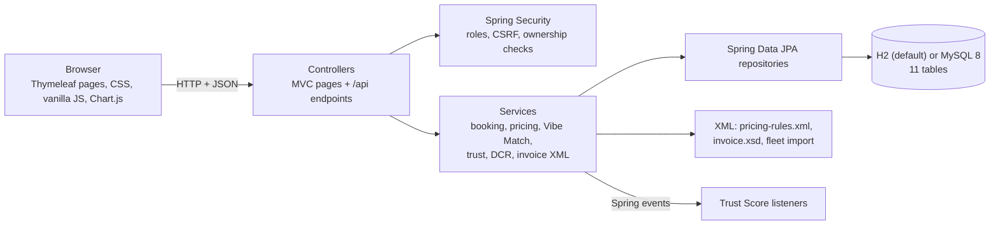
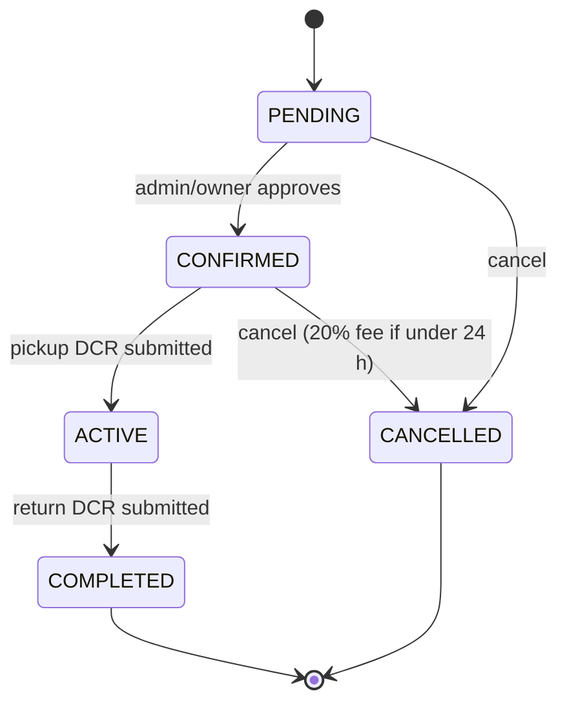
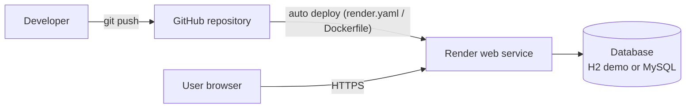

# DriveSense: Smart Car Rental Platform

> A smart car rental platform that recommends cars for your trip, explains every rupee of the price, and protects both sides with a digital condition report.

The platform controls availability, pricing and trust, so nobody argues about double booking, price or damage.

- Live Demo: https://drivesense-platform.onrender.com/ (Render; first request after idle may take 30-60 seconds to spin up)
- Video Explanation: https://youtu.be/Qxms8NXEPjs?si=-aLvsW6RW6gpMtSQ
- Repository: https://github.com/adityakhuteta05/Vehicle-Rental-System
- Academic Context: Advanced Java Project-Based Learning (PBL), 5th Semester, CSE / AI&DS / IT
- Institution: Arya College of Engineering & I.T., Jaipur (Affiliated to RTU, Kota)
- Project Period: 06-07-2026 to 27-09-2026 (12 weeks)

### 📚 Project Documentation

All academic documentation, research, software requirements, and presentation materials for the DriveSense project are available in the Google Drive folder below.

📂 **[Access All Project Documents – Google Drive](https://drive.google.com/drive/folders/1AskUadGGHzbaiv3JICaixStV4u9IFe0J?usp=drive_link)**

The folder contains:

- 📄 **Project Report** – Detailed documentation of the DriveSense platform.
- 🔬 **Research Paper** – Research and technical background related to the project.
- 📋 **Software Requirements Specification (SRS)** – Functional and non-functional requirements.
- 📊 **Project Presentation (PPT)** – Slides covering the project overview and implementation.

### Team Members
- Aditya Khuteta (24EARAD007) - Team Leader
- Avi Maanju (24EARAD026)
- Aryan Katariya (24EARAD022)
- Gaurav Yadav (24EARAD053)
- Aditya Gautam (24EARAD006)

---

## Table of Contents

- [1. About](#1-about)
- [2. Features](#2-features)
- [3. SRS Summary](#3-srs-summary)
- [4. System Architecture](#4-system-architecture)
- [5. Tech Stack](#5-tech-stack)
- [6. Project Structure](#6-project-structure)
- [7. Getting Started](#7-getting-started)
- [8. Environment Variables](#8-environment-variables)
- [9. Database](#9-database)
- [10. How It Works](#10-how-it-works)
  - [10.1 Booking and Concurrency](#101-booking-and-concurrency)
  - [10.2 Dynamic Pricing Engine](#102-dynamic-pricing-engine)
  - [10.3 Vibe Match Recommender](#103-vibe-match-recommender)
  - [10.4 Digital Condition Report (DCR)](#104-digital-condition-report-dcr)
  - [10.5 Trust Score and Loyalty Tiers](#105-trust-score-and-loyalty-tiers)
  - [10.6 Cancellation Policy](#106-cancellation-policy)
  - [10.7 Trip Carbon Footprint Estimator](#107-trip-carbon-footprint-estimator)
  - [10.8 XML Ecosystem and Enterprise Integration](#108-xml-ecosystem-and-enterprise-integration)
- [11. Testing](#11-testing)
- [12. Deployment](#12-deployment)
- [13. Team and Week-Wise Work](#13-team-and-week-wise-work)
  - [13.1 Team and Module Ownership](#131-team-and-module-ownership)
  - [13.2 Week-Wise Work Log](#132-week-wise-work-log)
- [14. Current Status, Limits, and Future Scope](#14-current-status-limits-and-future-scope)
- [15. Licence and Acknowledgements](#15-licence-and-acknowledgements)

---

## 1. About

Traditional vehicle rental operations rely heavily on offline phone calls, physical paper receipts, and uncoordinated spreadsheets. This creates recurring friction points:
- Double bookings caused by race conditions during peak holiday seasons.
- Damage disputes at vehicle return due to unrecorded or subjective pickup notes.
- Arbitrary, opaque pricing surcharges that erode customer trust.
- Catalogue fatigue where static listings leave users guessing whether a vehicle fits their specific journey context.

DriveSense is an intelligent, full-featured car rental platform designed to be smart rather than just a static inventory catalogue. It combines trip-intent vehicle matching (Vibe Match), dynamic rule-based pricing driven by XML strategies, interactive Digital Condition Reports (DCR) with zone-based damage auditing, automated customer Trust Scores with loyalty tiers, tailpipe carbon estimation, and database-level pessimistic row locking to guarantee booking integrity.

### User Roles and Needs

| Role | Target User | Key Needs and Operational Capabilities |
| :--- | :--- | :--- |
| Guest | Unauthenticated visitor | Browse vehicle catalogue, filter by powertrain and capacity, compare two cars, run Vibe Match wizard, preview dynamic pricing, and inspect rental policies. |
| Renter | Customer (18+ with driving licence) | Register and manage account, reserve vehicles with real-time availability checks, select optional extras, complete simulated checkout, inspect pickup/return condition reports, track Trust Score and loyalty perks, view and print invoices, and submit verified reviews. |
| Owner | Host / Fleet Supplier | Register as a vehicle host, view and manage assigned vehicles and booking schedules, start approved rental trips, and monitor ratings and earnings. |
| Admin | Platform Operator | Full administrative fleet CRUD, manual booking approval and status override, pickup and return DCR execution with automatic fee calculation, platform revenue and fleet utilisation metrics, and bulk fleet XML onboarding with schema validation. |

---

## 2. Features

### Accounts and Security
- Registration with full name, email, phone number, password, driving licence number, and date of birth.
- Strict age verification requiring renters to be at least 18 years old (`@AdultOnly` custom validator).
- Secure authentication and password hashing using BCrypt.
- Session-based authorization supporting Guest, Renter (`ROLE_RENTER` / `ROLE_CUSTOMER`), Owner (`ROLE_OWNER`), and Admin (`ROLE_ADMIN`) authorities.
- User profile management, password updates, and booking history tracking.

### Vehicle Catalogue
- Responsive vehicle cards displaying brand, model, daily and hourly rates, seats, transmission, fuel type, boot capacity, average rating, and carbon rating.
- Multi-parameter filtering by vehicle class (`HATCHBACK`, `SEDAN`, `SUV`, `LUXURY`, `EV`), fuel type (`PETROL`, `DIESEL`, `CNG`, `EV`), transmission (`MANUAL`, `AUTOMATIC`), seating capacity, and price range.
- Search by brand or model name with instant result updates.
- Sorting by price (ascending/descending) and customer rating.
- Server-side pagination for scalable inventory browsing.
- Detailed vehicle pages with photo galleries, specifications, feature lists, and booked-date calendars.
- Side-by-side vehicle comparison tool for evaluating two models simultaneously.

### Vibe Match Recommender
- Intent-based vehicle recommendation wizard evaluating journey type (`HILL_DRIVE`, `WEDDING`, `OFFICE_COMMUTE`, `FAMILY`, `WEEKEND`, `BUSINESS`, `AIRPORT`), passenger count, luggage volume, budget limit, and rental dates.
- Weighted vector matching algorithm implemented using Java 17 Streams.
- Returns top 3 available vehicles with match percentage score (30% to 99%) and human-readable recommendation justification.

### Booking and Pricing
- Add-on extras selection: Chauffeur (Rs. 800/day), Comprehensive Insurance (Rs. 350/day), and Child Seat (Rs. 200/day).
- Real-time slot availability check backed by database pessimistic locking.
- Itemized pricing breakdown: base duration cost, weekend surcharge, festival surcharge, long-rental discount, early-bird discount, loyalty discount, and 18% GST.
- Refundable security deposit calculation with loyalty tier waivers.
- Simulated payment checkout supporting Card, UPI, and Net Banking.
- Comprehensive cancellation handling with tiered fee calculation based on pickup timing.
- Customer booking timeline with status tracking (`PENDING`, `CONFIRMED`, `ACTIVE`, `COMPLETED`, `CANCELLED`).

### Digital Condition Report (DCR)
- Six-zone interactive vehicle inspection scheme covering `FRONT`, `REAR`, `LEFT`, `RIGHT`, `ROOF`, and `INTERIOR`.
- Pickup inspection recording fuel percentage, odometer reading, pre-existing blemishes, and inspector notes, transitioning booking to `ACTIVE`.
- Return inspection capturing final fuel level, final odometer reading, return notes, and newly damaged zones, transitioning booking to `COMPLETED`.
- Automated discrepancy calculations: extra kilometer charges, fuel deficit penalties (Rs. 25 per missing percentage point), and damage charges (Rs. 2,500 per newly damaged zone).

### Trust Score and Loyalty
- Dynamic customer reputation score starting at 50, bounded between 0 and 100.
- Three loyalty tiers: Silver (0 to 59), Gold (60 to 84), and Platinum (85 to 100).
- Tier-based perks: Gold gets 3% rental discount and 50% deposit waiver; Platinum gets 6% rental discount and 100% deposit waiver.
- Complete audit trail preserved in the `trust_events` table for transparent score tracking.

### Reviews and Carbon Estimator
- Verified customer reviews and 1 to 5 star ratings restricted exclusively to completed bookings.
- Dynamic aggregation of average vehicle ratings across the catalogue.
- Tailpipe CO2 emissions estimator calculating expected trip impact based on powertrain ratings and planned distance.
- Zero-tailpipe emission green eco badges for electric vehicles (EV).

### XML Enterprise Integration
- Strategy-driven dynamic pricing rules unmarshalled from `pricing-rules.xml` using JAXB at application startup.
- Electronic tax invoice generation marshalled to XML via JAXB and validated against `invoice.xsd`.
- Clean, printable HTML invoice with dedicated print stylesheet.
- Administrative bulk fleet onboarding from XML files with reference schema validation (`fleet.xsd`) and per-record error diagnostics.

### Admin and Owner Tools
- Dedicated Owner dashboard providing fleet overview, vehicle availability, rental status, and booking management.
- Comprehensive Admin dashboard displaying fleet metrics (total cars, rented cars, available cars, due today), Chart.js visualisations for monthly revenue and category distribution, fleet CRUD management, booking approval controls, DCR inspection workflows, and bulk XML import.

---

## 3. SRS Summary

### 3.1 Functional Requirements

| Module | Requirement Description | Priority |
| :--- | :--- | :--- |
| User Registration & Profile | User registration with personal details, licence number, DOB, and age verification (18+); profile updates and password changes. | High |
| Authentication & Authorization | BCrypt password hashing, Spring Security 6 session management, and role-based access for Guest, Renter, Owner, and Admin. | High |
| Vehicle Catalogue | Catalogue browsing with multi-parameter filtering (type, fuel, transmission, seats, price), sorting, search, and pagination. | High |
| Vehicle Comparison | Side-by-side specification comparison of two vehicles selected by the customer. | Medium |
| Vibe Match Recommender | Multi-step trip wizard scoring available vehicles against trip intent, budget, and capacity; returns top 3 ranked cars with justifications. | High |
| Availability & Concurrency | Real-time date availability checking with pessimistic row locking to prevent overlapping reservations. | High |
| Booking Management | End-to-end booking lifecycle (`PENDING` -> `CONFIRMED` -> `ACTIVE` -> `COMPLETED` / `CANCELLED`) with unique booking code generation. | High |
| Dynamic Pricing Engine | Strategy-based pricing calculation incorporating duration, weekend uplift, festival surcharge, long-stay discounts, loyalty tiers, and 18% GST. | High |
| Booking Extras & Add-ons | Selection of optional extras (Chauffeur, Insurance, Child Seat) with per-day rate calculations. | Medium |
| Payment Simulation | Checkout simulation supporting Card, UPI, and Net Banking with transaction reference tracking. | High |
| Cancellation Handling | Cancellation workflows with automated 20% penalty fee and Trust Score penalty (-3) when cancelled within 24 hours of pickup. | High |
| Digital Condition Report (DCR) | Pickup and return inspections across 6 vehicle zones, auto-computing excess km, missing fuel, and damage penalties. | High |
| Trust Score & Loyalty | Dynamic score (0-100) with event-driven adjustments and tier-based discounts/deposit waivers; immutable audit logging. | High |
| Customer Reviews | Submission of 1-5 star ratings and reviews restricted to completed rentals; updates vehicle average rating. | Medium |
| Carbon Footprint Estimator | Estimation of trip CO2 emissions based on planned distance and powertrain factors; eco badges for EVs. | Medium |
| XML Invoicing | JAXB generation of XML invoices validated against `invoice.xsd`, accompanied by printable HTML invoice views. | High |
| Bulk Fleet XML Import | Administrative batch upload of vehicle fleets from XML documents with schema checking and record-level error reports. | High |
| Owner Dashboard | Fleet overview, active booking schedules, trip dispatch, and earnings tracking for vehicle hosts. | High |
| Admin Dashboard & Analytics | Centralised operational metrics, revenue and category distribution charts, and user account oversight. | High |
| Validation & Error Handling | Comprehensive bean validation on form inputs and centralized exception handling with friendly error pages. | High |

### 3.2 Non-Functional Requirements

| Category | Requirement Specification |
| :--- | :--- |
| Security | Passwords hashed using BCrypt. Role-based access control enforced via Spring Security 6 filter chain. CSRF protection enabled on form submissions. Strict entity ownership checks on booking actions and invoice views. |
| Performance | Atomic availability verification executed under pessimistic database locks. Fast sub-second AJAX responses for `/api/price/preview` and `/api/cars/{id}/booked-dates`. Server-side pagination on vehicle catalogue. |
| Usability | Clean, responsive dark-mode interface with consistent design tokens. Interactive SVG vehicle inspection map for condition reporting. Multi-step guided wizard for Vibe Match. Dedicated print CSS for invoices. |
| Reliability | ACID-compliant transaction boundaries (`@Transactional` with `READ_COMMITTED` isolation) preventing inconsistent booking states. Centralized error handling (`GlobalExceptionHandler`) preventing uncaught stack traces. |
| Maintainability | Strict layered architecture separating web presentation, service domain logic, and JPA persistence. Design patterns (Strategy, Builder, Observer, DTO) decouple business rules from infrastructure. |
| Portability | Self-contained Spring Boot application deployable with embedded H2 or external MySQL 8. Docker and Docker Compose container definitions for cross-platform Linux/macOS/Windows execution. |

### 3.3 System Requirements

- Software Requirements:
  - Java Development Kit: OpenJDK 17 or higher
  - Web Browser: Google Chrome, Mozilla Firefox, Microsoft Edge, or Safari
  - Version Control: Git 2.30+
  - Build Tool: Apache Maven 3.8+ (Maven wrapper `mvn.cmd` / `mvnw` provided in repository)
  - Container Engine (Optional): Docker 20.10+ and Docker Compose v2+
- Hardware Requirements:
  - RAM: Minimum 4 GB (8 GB recommended for running Docker containers locally)
  - Disk Space: Minimum 2 GB free disk space
  - Processor: 64-bit dual-core 2.0 GHz or higher

---

## 4. System Architecture

DriveSense implements a classic layered enterprise architecture. Web presentation is delivered via server-side Thymeleaf templates enhanced with vanilla JavaScript and Chart.js for data visualization. HTTP requests pass through the Spring Security 6 filter chain before reaching Spring MVC controllers (`@Controller` and REST `@RestController` endpoints). Controllers delegate all business workflows to service beans, which coordinate domain calculations, publish application events, unmarshal XML configurations, and persist data using Spring Data JPA repositories backed by H2 or MySQL 8.

Cross-cutting capabilities include:
- Spring Security 6: URL pattern authorization, authentication providers, and CSRF token verification.
- Global Exception Handler: Unified error interception mapping domain exceptions (`CarNotAvailableException`, `ResourceNotFoundException`) to user-friendly views.
- Jakarta Bean Validation: Declarative validation constraints on DTO objects and entities.
- Logging: SLF4J with Logback recording critical booking operations and security events.

### Architecture Diagram



### Booking Status Life Cycle



### Deployment Flow



---

## 5. Tech Stack

| Layer | Technology | Details and Version |
| :--- | :--- | :--- |
| Language | Java | Java 17 LTS (Java 17 / 21 / 25 compatible runtime) |
| Framework | Spring Boot | Spring Boot 3.3.4 (Web MVC, Data JPA, Security 6, Validation) |
| Templating | Thymeleaf | Thymeleaf 3 with `thymeleaf-extras-springsecurity6` integration |
| ORM / Persistence | Hibernate / JPA | Hibernate 6.5 managed by Spring Data JPA |
| Database | H2 / MySQL | H2 In-Memory (MySQL Mode) by default; MySQL 8.0 for persistent storage |
| Security | Spring Security | Spring Security 6 with BCrypt password hashing and session management |
| XML Processing | JAXB & XSD | Jakarta XML Binding 4.0 (`jakarta.xml.bind-api`, `jaxb-runtime`) with strict XSD validation |
| Build Tool | Maven | Apache Maven 3.9+ with included cross-platform Maven wrapper (`mvn.cmd` / `mvnw`) |
| Testing | JUnit 5 & Spring Test | JUnit Jupiter 5, Spring Boot Test, Spring Security Test, multithreaded concurrency tests |
| Front End | HTML5, CSS3, JS | Vanilla CSS3 (custom dark glassmorphism system), Vanilla JS (ES6+), Chart.js 4.4 |
| Containers | Docker & Compose | Multi-stage Dockerfile (`eclipse-temurin:17`), `docker-compose.yml` with MySQL 8 service |
| Hosting & Platform | Render / Cloud VPS | Configured for Render (`render.yaml`), Railway, Procfile, or standalone Linux VPS |

---

## 6. Project Structure

```
Vehicle-Rental-System/
├── pom.xml                               # Project dependencies (Spring Boot 3.3.4, Security, JPA, JAXB)
├── mvn.cmd / mvnw.cmd                    # Maven wrappers for Windows and Unix
├── Dockerfile                            # Multi-stage production container build (JDK build -> JRE runtime)
├── docker-compose.yml                    # Stack definition running MySQL 8 and DriveSense web service
├── render.yaml                           # Infrastructure as code for Render Docker web service
├── Procfile                              # Platform execution command for cloud PaaS
├── DEPLOYMENT_GUIDE.md                   # Comprehensive deployment documentation
├── src/
│   ├── main/
│   │   ├── java/com/drivesense/
│   │   │   ├── DriveSenseApplication.java# Application main entry point
│   │   │   ├── config/                   # SecurityConfig, DataInitializer, XmlConfig
│   │   │   ├── controller/               # HomeController, CarController, BookingController, AdminController,
│   │   │   │                             # OwnerController, ApiRestController
│   │   │   ├── dto/                      # BookingRequest, PriceBreakdown, VibeRequest, CarCard, DcrRequest
│   │   │   │   └── xml/                  # FleetXml, CarXml (JAXB data transfer models)
│   │   │   ├── entity/                   # User, Car, Location, Booking, BookingExtra, Payment,
│   │   │   │                             # ConditionReport, Review, TrustEvent, OwnerProfile
│   │   │   ├── enums/                    # CarType, FuelType, BookingStatus, TripType, TrustTier, DamageZone
│   │   │   ├── event/                    # BookingCancelledEvent, DamageReportedEvent, ReviewSubmittedEvent
│   │   │   ├── exception/                # CarNotAvailableException, ResourceNotFoundException, GlobalExceptionHandler
│   │   │   ├── pricing/                  # PricingRule (Strategy), WeekendRule, FestivalRule, LongRentalRule,
│   │   │   │                             # EarlyBirdRule, LoyaltyRule, PriceBreakdownBuilder
│   │   │   ├── repository/               # CarRepository, BookingRepository, UserRepository,
│   │   │   │                             # OwnerProfileRepository, ReviewRepository, ConditionReportRepository
│   │   │   ├── service/                  # BookingService, PricingService, VibeMatchService, DcrService,
│   │   │   │                             # TrustScoreService, InvoiceXmlService, FleetImportService, OwnerService
│   │   │   └── util/                     # CarbonCalculator, DateUtil
│   │   └── resources/
│   │       ├── application.properties    # Default profile (H2 in-memory MySQL mode, web port 8080)
│   │       ├── application-mysql.properties # Production MySQL connection profile
│   │       ├── schema.sql                # Complete relational DDL schema (11 tables)
│   │       ├── data.sql                  # Standalone SQL demo seed records
│   │       ├── static/
│   │       │   ├── css/
│   │       │   │   └── style.css         # Complete custom styling and dark design tokens
│   │       │   └── js/
│   │       │       ├── main.js           # Navigation, filters, and notification helpers
│   │       │       ├── booking.js        # Checkout stepper and dynamic price preview fetcher
│   │       │       ├── dcr.js            # Interactive vehicle damage zone selector
│   │       │       └── admin-charts.js   # Chart.js revenue and fleet utilization visualisations
│   │       ├── templates/                # Thymeleaf HTML views
│   │       │   ├── index.html            # Landing page with hero, search, and journey categories
│   │       │   ├── cars/                 # Catalogue listing and vehicle detail views
│   │       │   ├── vibe-match/           # Multi-step journey recommendation wizard
│   │       │   ├── booking/              # Reservation form, checkout, and customer history
│   │       │   ├── owner/                # Host fleet overview and booking controls
│   │       │   ├── admin/                # Admin analytics, fleet management, and XML bulk import
│   │       │   └── invoice/              # Printable electronic invoice view
│   │       └── xml/
│   │           ├── pricing-rules.xml     # Dynamic pricing strategy rules
│   │           ├── invoice.xsd           # XML Schema Definition for electronic invoices
│   │           ├── fleet.xsd             # XML Schema Definition for bulk fleet uploads
│   │           └── sample-fleet.xml      # Sample XML dataset for administrative fleet import
│   └── test/java/com/drivesense/service/
│       ├── BookingConcurrencyTest.java   # Multithreaded pessimistic locking test
│       ├── PricingServiceTest.java       # Unit tests for pricing strategies and breakdowns
│       ├── VibeMatchServiceTest.java     # Unit tests for recommendation scoring and ranking
│       ├── TrustScoreServiceTest.java    # Unit tests for trust adjustments and clamping
│       └── InvoiceXmlServiceTest.java    # Integration test for JAXB marshaling against invoice.xsd
└── README.md
```

### Architectural Working Rules
- Layered Control Flow: Incoming requests always flow strictly: `Browser -> Controller -> Service -> Repository -> Database`. Controllers never execute raw database queries or direct repository mutations.
- DTO Encapsulation: Controllers accept and return dedicated Data Transfer Objects (`BookingRequest`, `PriceBreakdown`, `VibeRequest`) to prevent exposing persistent JPA entities to external manipulation.
- Strict Type Safety: Domain states (booking status, vehicle fuel types, damage zones, trust tiers) are enforced with Java enums rather than loose string literals.
- Environment-Driven Configuration: Sensitive settings, database credentials, and runtime ports are injected via environment variables rather than hardcoded in source repositories.

---

## 7. Getting Started

### Prerequisites
- Java 17 JDK or higher installed (`java -version`).
- Git installed (`git --version`).
- Optional: Docker and Docker Compose for running with MySQL 8.

### Step 1: Clone the Repository
```bash
git clone https://github.com/adityakhuteta05/Vehicle-Rental-System.git
cd Vehicle-Rental-System
```

### Step 2: Run the Application

#### Option A: Run Locally with Embedded H2 (Default, Zero-Setup)
This launches the platform immediately with an in-memory database pre-seeded with sample vehicles, locations, and users:

- Windows:
  ```powershell
  .\mvn.cmd spring-boot:run
  ```
- Mac / Linux:
  ```bash
  ./mvnw spring-boot:run
  ```

#### Option B: Run with Docker Compose (Production MySQL 8)
This builds the application image and launches a connected MySQL 8 container with persistent volume storage:
```bash
docker compose up --build -d
```

### Step 3: Access the Platform
Once booted, open your browser and navigate to:
```
http://localhost:8080/
```

### Pre-Configured Demo Accounts

> Important Notice: The accounts listed below are pre-seeded demo accounts intended strictly for evaluation and demonstration. Change their passwords or remove them before deploying to a public production environment.

| Role | Email Address | Password | Permissions and Initial Seed State |
| :--- | :--- | :--- | :--- |
| Fleet Admin | `admin@drivesense.com` | `admin123` | Full access to `/admin`, fleet management, DCR inspections, revenue analytics, and XML fleet import. |
| Vehicle Owner | `owner@drivesense.com` | `owner123` | Access to `/owner/dashboard`, host fleet management, trip start actions, and earnings overview. |
| Gold Renter | `user@example.com` | `user123` | Trust Score 78 (Gold Tier: 3% rental discount, 50% deposit waiver), past booking `DS-2026-000123`. |
| Platinum VIP | `vip@example.com` | `vip123` | Trust Score 92 (Platinum Tier: 6% rental discount, 100% zero deposit waiver). |

### Step 4: Run the Test Suite
Execute the automated test suite with Maven:
```bash
# Windows
.\mvn.cmd test

# Mac / Linux
./mvnw test
```

---

## 8. Environment Variables

DriveSense is configured to pull database credentials and port bindings directly from environment variables.

| Variable Name | Default Value | Description |
| :--- | :--- | :--- |
| `SPRING_DATASOURCE_URL` | `jdbc:h2:mem:drivesensedb;DB_CLOSE_DELAY=-1;DB_CLOSE_ON_EXIT=FALSE;MODE=MySQL` | JDBC connection URL for the relational database. Point to MySQL in production. |
| `SPRING_DATASOURCE_DRIVER_CLASS_NAME` | `org.h2.Driver` | JDBC driver class name (`com.mysql.cj.jdbc.Driver` when using MySQL). |
| `SPRING_DATASOURCE_USERNAME` | `sa` | Username for database authentication. |
| `SPRING_DATASOURCE_PASSWORD` | *(empty string)* | Password for database authentication. |
| `PORT` | `8080` | HTTP listening port for the embedded web container. |

### Operational Security Rules
- Never commit real passwords, production database URLs, or secret keys to the source repository.
- In production deployments, ensure the H2 Web Console is explicitly disabled by setting `spring.h2.console.enabled=false`.

---

## 9. Database

The persistence schema consists of 11 relational tables defined to support transactional vehicle rentals, condition reporting, and trust tracking:

1. `users`: Customer, host, and admin accounts containing contact information, password hashes, driving licence numbers, date of birth, and Trust Scores.
2. `locations`: Operational hubs, airport pickup points, and city stations.
3. `cars`: Vehicle inventory with brand, model, registration numbers, classifications, daily/hourly rates, extra kilometer tariffs, carbon ratings, and status.
4. `car_features`: Many-to-one mapping storing individual amenities for each vehicle (e.g., Sunroof, 360 Camera, ADAS).
5. `bookings`: Rental reservations storing start and end dates, actual return timestamps, trip intents, itemized pricing amounts, security deposits, and carbon estimates.
6. `booking_extras`: Add-ons attached to reservations (Chauffeur, Comprehensive Insurance, Child Seat).
7. `payments`: Payment audit entries recording transaction references, payment methods, amounts, and statuses.
8. `condition_reports`: Inspection reports recorded at vehicle pickup and return capturing fuel levels, odometer readings, and damage zones.
9. `reviews`: Customer ratings and feedback linked directly to completed bookings.
10. `trust_events`: Append-only audit trail logging every customer Trust Score modification, reason, and resulting score.
11. `owner_profiles`: Commercial information, verification status, government ID, and earnings metrics for vehicle hosts.

### Database Integrity Rules and Constraints
- Unique Constraints: Enforced on `users.email`, `cars.reg_number`, `bookings.booking_code`, and `reviews.booking_id` (ensuring exactly one review per booking).
- Concurrency Index: A composite index is defined on `bookings(car_id, start_time, end_time)` to accelerate overlapping reservation lookups.
- Date Sanity Check: Table check constraint `CHECK (end_time > start_time)` prevents inverted reservation windows.
- Audit Immutability: `trust_events` operates as an audit log where entries are created whenever score adjustments occur.
- Persistence Lifecycle: The default H2 database runs in-memory and re-seeds clean demo data on each restart via `DataInitializer`. For production persistence, use MySQL 8.
- Backup Strategy: When using MySQL, generate database dumps using `mysqldump`:
  ```bash
  mysqldump -u drivesense -p drivesense > drivesense_backup.sql
  ```

---

## 10. How It Works

### 10.1 Booking and Concurrency
- Transaction Boundary: Booking creation executes inside a single `@Transactional` method operating under `READ_COMMITTED` transaction isolation.
- Pessimistic Row Locking: Before evaluating availability, the service acquires an exclusive write lock on the target car entity row using JPA's `@Lock(LockModeType.PESSIMISTIC_WRITE)`.
- Overlap Detection: A vehicle is deemed unavailable if another booking exists with status `CONFIRMED` or `ACTIVE` that overlaps the requested window:
  ```
  existing.start_time < requested.end_time AND existing.end_time > requested.start_time
  ```
- Back-to-Back Bookings: Back-to-back rentals are permitted (for example, Booking A ending at 10:00 AM and Booking B starting at 10:00 AM do not overlap).
- Concurrency Test: Verified by `BookingConcurrencyTest.java`, which launches two simultaneous threads using `ExecutorService` and `CountDownLatch`. Exactly one transaction commits successfully while the other is rejected with a `CarNotAvailableException`.

### 10.2 Dynamic Pricing Engine
Pricing calculations follow the Strategy Design Pattern. Individual rules are unmarshalled from `pricing-rules.xml` using JAXB during application startup and assembled into the final breakdown using a fluent builder:

| Rule Name | Calculation Logic and Effect |
| :--- | :--- |
| Base Duration | `pricePerHour * hours` if duration is under 24 hours; `pricePerDay * days` if 24 hours or longer. |
| Weekend Surcharge | +10% of the daily rate applied for each Saturday or Sunday in the rental window. |
| Festival Surcharge | +15% surcharge applied when booking falls inside configured holiday date ranges. |
| Long Rental Discount | -5% discount on base rental for bookings of 3 to 6 days; -12% discount for rentals of 7 days or more. |
| Early Bird Discount | -7% discount applied when the reservation is created 14 or more days in advance of pickup. |
| Loyalty Discount | Tier-based discount: Silver (0%), Gold (-3%), Platinum (-6%). |
| Add-on Extras | Chauffeur at Rs. 800/day, Comprehensive Insurance at Rs. 350/day, Child Seat at Rs. 200/day. |
| Subtotal and GST | `Subtotal = Base + Surcharges - Discounts + Extras`. GST is calculated at 18% of subtotal; `Total = Subtotal + GST`. |
| Security Deposit | Base deposit of Rs. 3,000 multiplied by tier factor: Silver (1.0 = Rs. 3,000), Gold (0.5 = Rs. 1,500), Platinum (0.0 = Rs. 0). |

### 10.3 Vibe Match Recommender
The Vibe Match engine evaluates available vehicles using a multi-factor weighted scoring formula implemented with Java 17 Streams:

$$\text{Score} = 0.35 \times \text{seatFit} + 0.20 \times \text{luggageFit} + 0.20 \times \text{budgetFit} + 0.15 \times \text{tripTypeFit} + 0.10 \times \text{ratingScore}$$

- Final score is rounded and clamped between 30 and 99 points.
- `seatFit`: 100 if vehicle seats cover passengers with at most 2 spare seats; minus 15 per extra empty seat (minimum score 20); 0 if vehicle has fewer seats than requested passengers.
- `luggageFit`: 100 for exact match, 85 if boot is larger than requested, minus 45 per level if smaller (minimum 10).
- `budgetFit`: 100 if vehicle rate is within user budget; scales down linearly to 0 at 30% above budget.
- `tripTypeFit`: Matrix lookup where `HILL_DRIVE` favours SUVs, `WEDDING` favours Luxury and Sedans, `OFFICE_COMMUTE` favours EVs and Hatchbacks, and `FAMILY` favours 7-seaters.
- `ratingScore`: Evaluated as `(average_rating / 5.0) * 100`.
- Only vehicles available for the requested calendar dates are evaluated. The engine returns the top 3 cars sorted by score along with an auto-generated justification sentence.

### 10.4 Digital Condition Report (DCR)
- Pickup Inspection: Records odometer reading, fuel percentage, pre-existing damage zones (`FRONT`, `REAR`, `LEFT`, `RIGHT`, `ROOF`, `INTERIOR`), and photos/notes. Submitting the pickup DCR transitions the booking from `CONFIRMED` to `ACTIVE`.
- Return Inspection: Captures return odometer reading, return fuel level, return notes, and newly discovered damage zones. Submitting the return report transitions the booking to `COMPLETED` and logs the actual return timestamp.
- Automatic Charge Discrepancies:
  - Excess Kilometers: `Extra km = distance - (days * km_per_day_limit)`, charged at the vehicle's extra kilometer rate.
  - Missing Fuel Penalty: Charged at Rs. 25 per missing percentage point below pickup level.
  - Body Damage Penalty: Charged at Rs. 2,500 per newly damaged zone not present at pickup. New damage triggers a `DamageReportedEvent` penalising the customer's Trust Score by -10 points.

### 10.5 Trust Score and Loyalty Tiers
- Baseline Score: Every new user starts at 50 points; the score is strictly clamped between 0 and 100.
- Audit Tracking: Every score delta is stored as an immutable record in `trust_events`.
- Tier Structure:
  - Silver (0 to 59): Standard pricing, 100% security deposit required.
  - Gold (60 to 84): 3% rental discount, 50% security deposit waiver.
  - Platinum (85 to 100): 6% rental discount, 100% zero security deposit.
- Active Event Triggers:
  - 5-Star verified review: `+1 point`
  - Booking cancellation within 24 hours of pickup: `-3 points`
  - New damage detected in Return DCR: `-10 points`
  - On-time vehicle return: `+5 points` (listener implemented; see limits)
  - Late vehicle return: `-5 points` (listener implemented; see limits)

### 10.6 Cancellation Policy
- Cancellations made more than 24 hours before scheduled pickup incur no cancellation charge and no trust penalty.
- Cancellations made within 24 hours of pickup incur a 20% cancellation fee recorded as an extra charge and deduct 3 points from the customer's Trust Score.
- Ownership checks enforce that only the booking owner or an administrator can cancel a reservation.

### 10.7 Trip Carbon Footprint Estimator
- Carbon emissions are computed using the formula:
  $$\text{CO}_2\text{ (kg)} = \frac{\text{co2GPerKm} \times \text{distance}}{1000}$$
- Distance is estimated as $\max(80\text{ km}, 150\text{ km} \times \text{days})$.
- Electric vehicles (EV) have 0 g/km tailpipe emissions and receive a distinct green eco badge in the user interface.

### 10.8 XML Ecosystem and Enterprise Integration
- Dynamic Pricing Configuration: Business rules are externalised in `pricing-rules.xml` and loaded dynamically via JAXB, allowing rule updates without recompiling code.
- Electronic Invoices: Generated booking invoices are marshalled into XML via JAXB and validated against `invoice.xsd`.
- Printable Invoice: A dedicated HTML template provides an invoice view styled with print media CSS.
- Bulk Fleet Onboarding: Administrators can upload vehicle fleet XML files. While `fleet.xsd` serves as the schema specification, import parsing verifies uniqueness of registration numbers and mandatory attributes, returning record-by-record error messages upon completion.

---

## 11. Testing

### Test Strategy
DriveSense utilizes a tiered testing strategy combining automated unit tests, integration tests with in-memory persistence, XML validation tests, and multithreaded concurrency tests. Security authorization boundaries and UI flows were verified through manual test suites.

### Automated Test Classes
The following test suites are located in `src/test/java/com/drivesense/service/`:
- `BookingConcurrencyTest.java`: Spawns concurrent threads using `ExecutorService` and `CountDownLatch` attempting to book the identical vehicle simultaneously to verify pessimistic locking.
- `PricingServiceTest.java`: Tests duration calculations, weekend uplifts, long-rental discounts, loyalty multipliers, tax calculations, and deposit waivers.
- `VibeMatchServiceTest.java`: Verifies the 5-attribute vector scoring algorithm, ranking orders, and clamped score boundaries.
- `TrustScoreServiceTest.java`: Verifies event handling, clamping between 0 and 100, and tier transitions.
- `InvoiceXmlServiceTest.java`: Tests JAXB marshaling of invoice data and validates generated XML against `invoice.xsd`.

### Test Cases Summary

| ID | Test Case | Expected Result | Type |
| :--- | :--- | :--- | :--- |
| TC-01 | Two simultaneous bookings for identical car and overlapping slot | Exactly one booking succeeds; second request rejected with `CarNotAvailableException` | Auto |
| TC-02 | Booking with duration under 24 hours | Hourly rate applied | Auto |
| TC-03 | Booking with duration of 7 or more days | Long-rental discount (-12%) applied to base amount | Auto |
| TC-04 | Platinum customer reservation | 6% loyalty discount applied and zero security deposit required | Auto |
| TC-05 | Tax calculation on rental subtotal | 18% GST correctly computed and added to subtotal | Auto |
| TC-06 | Vibe Match recommendations | Maximum 3 vehicles returned sorted in descending score order | Auto |
| TC-07 | Trust score increment exceeding maximum | Score clamped at 100 | Auto |
| TC-08 | Trust score decrement falling below minimum | Score clamped at 0 | Auto |
| TC-09 | XML invoice generation | Generated XML strictly validates against `invoice.xsd` schema | Auto |
| TC-10 | Registration with date of birth under 18 years | Form submission rejected with age constraint validation error | Manual |
| TC-11 | Registration with existing email address | Form rejected with duplicate email error message | Manual |
| TC-12 | Administrator successful login | Redirected directly to `/admin` dashboard | Manual |
| TC-13 | Renter attempts accessing `/admin` URL | Access denied with HTTP 403 Forbidden | Manual |
| TC-14 | Unauthenticated guest attempts accessing `/my-bookings` | Redirected to `/login` authentication prompt | Manual |
| TC-15 | Booking with overlapping dates on reserved car | Validation error displayed; reservation rejected | Manual |
| TC-16 | Booking with pickup date set in the past | Validation error displayed; reservation rejected | Manual |
| TC-17 | Booking cancellation more than 24 hours before pickup | Booking marked cancelled with zero cancellation fee | Manual |
| TC-18 | Booking cancellation within 24 hours of pickup | 20% penalty fee charged and customer Trust Score reduced by 3 points | Manual |
| TC-19 | Customer attempts cancelling another user's booking | Request rejected due to ownership authorization check | Manual |
| TC-20 | Return DCR reports new body damage | Rs. 2,500 damage fee per zone added and Trust Score reduced by 10 points | Manual |
| TC-21 | Return DCR reports fuel below pickup level | Fuel charge of Rs. 25 per missing percentage point added | Manual |
| TC-22 | Return DCR reports odometer exceeding daily limit | Extra kilometer charge calculated at vehicle tariff | Manual |
| TC-23 | XML Fleet import containing duplicate registration number | Duplicate record skipped with error log; valid records imported | Manual |
| TC-24 | XML Fleet import with malformed XML syntax | Upload rejected with descriptive XML parsing error message | Manual |
| TC-25 | Live preview request to `/api/price/preview` | Returns JSON breakdown with subtotal, taxes, discounts, and deposit | Manual |

### Executing Tests
```bash
# Run all automated tests via Maven
mvn test
```

---

## 12. Deployment

DriveSense supports multiple deployment strategies ranging from cloud container platforms to local orchestration. Detailed step-by-step procedures are documented in [DEPLOYMENT_GUIDE.md](file:///c:/Users/hp/Desktop/Vehical%20Rental%20System/DEPLOYMENT_GUIDE.md).

### Deployment Options
1. Render Cloud Web Service: Configured via `render.yaml` utilizing the multi-stage `Dockerfile`.
2. Docker Compose with MySQL 8: Complete containerized stack orchestrating application and persistent MySQL 8 service with health checks.
3. Railway / VPS Deployment: Deployable as a packaged jar executable on any cloud host with Java 17 runtime support.

### Build Command
```bash
mvn clean package -DskipTests
```

### Production Smoke-Test Checklist
1. Home View: Load `http://localhost:8080/` and verify hero section, brand assets, and quick search.
2. Authentication: Register a new user or log in with demo credentials.
3. Catalogue Browsing: Filter vehicles by type and fuel; open car details page.
4. Booking Workflow: Select dates, review pricing breakdown preview, and complete simulated checkout.
5. Invoicing: Access booking details, view printable HTML invoice, and download XSD-validated XML invoice.
6. Admin Operations: Log in as `admin@drivesense.com`, review dashboard metrics, verify fleet CRUD, execute DCR inspections, and test XML fleet import.
7. Security Verification: Attempt accessing `/admin` as a standard renter to verify HTTP 403 Forbidden enforcement.

> Note on Cloud Free Tier: The public live demo hosted on Render free tier spins down containers during idle periods. The initial HTTP request after inactivity may take 30 to 60 seconds to complete while the container launches.

---

## 13. Team and Week-Wise Work

### 13.1 Team and Module Ownership

| Member | Role | 5 Major Modules Assigned |
| :--- | :--- | :--- |
| Aditya Khuteta (24EARAD007) | Team Leader; Authentication, Security & Trust Score | 1. User Registration & Profile<br>2. Authentication<br>3. Authorization & Application Security<br>4. Validation & Error Handling<br>5. Trust Score & Loyalty |
| Avi Maanju (24EARAD026) | Admin, DCR & XML | 1. Admin Dashboard<br>2. Admin Fleet Management<br>3. Admin Booking Management<br>4. Digital Condition Report<br>5. Invoice, XML & Reporting |
| Aryan Katariya (24EARAD022) | Booking Core Developer (Main integration merger) | 1. Project Setup & Configuration<br>2. Booking Management<br>3. Availability & Concurrency<br>4. Dynamic Pricing Engine<br>5. Payment & Booking Completion |
| Gaurav Yadav (24EARAD053) | Fleet, Catalogue & Smart Features | 1. Vehicle Catalogue<br>2. Search, Filter & Comparison<br>3. Car Details & Availability Display<br>4. Vibe Match Recommender<br>5. Reviews & Carbon Estimator |
| Aditya Gautam (24EARAD006) | Frontend, QA & Documentation (QA Lead) | 1. UI/UX Design System<br>2. Customer Frontend<br>3. Booking & Checkout Frontend<br>4. Admin/Invoice Frontend & JavaScript Integration<br>5. QA, Testing & Documentation |

#### Team Governance and Milestones
- Testing Responsibility: Every team member tests their own module components.
- QA Coordination: Aditya Gautam coordinates cross-module regression, UI verification, and the central defect log.
- Integration Approval: Aditya Khuteta approves weekly branch integrations and submits the combined weekly project report.
- Project Duration: 06-07-2026 to 27-09-2026 (12 weeks).
- Core Milestones:
  - Milestone 1 (End of Week 4): Working vehicle catalogue, search, and secure authentication foundation.
  - Milestone 2 (End of Week 9): End-to-end booking flow, dynamic pricing strategies, DCR inspections, and admin management.
  - Milestone 3 (End of Week 12): Fully tested release candidate, multi-environment verification, and final submission.

---

### 13.2 Week-Wise Work Log

#### Week 1 (06 Jul to 12 Jul): Research and Requirement Analysis

| Member | Work Completed |
| :--- | :--- |
| Aryan Katariya | Studied problem, user roles, booking workflow, Spring Boot/Maven/MySQL/Git set-up; fixed booking, pricing and payment ownership. |
| Aditya Khuteta | Researched authentication, authorization, validation and privacy; planned Spring Security, Trust Score and error handling. |
| Gaurav Yadav | Researched catalogue, search/filter, Vibe Match, review and carbon logic; planned Car, CarFeature and Location data. |
| Avi Maanju | Researched admin operations, DCR, JAXB/XSD invoice and import needs. |
| Aditya Gautam | Researched UI/UX and Thymeleaf patterns; prepared QA strategy and documentation checklist. |

#### Week 2 (13 Jul to 19 Jul): Database and Backend Foundation

| Member | Work Completed |
| :--- | :--- |
| Aryan Katariya | Spring Boot/Maven base project, MySQL and H2 profiles, environment placeholders, Git branches and conventions. |
| Aditya Khuteta | User entity, repository, DTOs, roles, Spring Security configuration classes, BCrypt foundation. |
| Gaurav Yadav | Car, CarFeature and Location entities, repositories, enums and sample data. |
| Avi Maanju | Admin controller/service structure, DCR entity, service interfaces for DCR, invoice and XML. |
| Aditya Gautam | Thymeleaf layout, design tokens, navbar/footer, asset folders and JavaScript utilities. |

#### Week 3 (20 Jul to 26 Jul): Authentication and Vehicle Foundation

| Member | Work Completed |
| :--- | :--- |
| Aryan Katariya | Booking entity, BookingStatus enum, booking code generator, date validation hooks and DB constraints. |
| Aditya Khuteta | Registration with validation, login/logout with BCrypt, profile edit and change password. |
| Gaurav Yadav | Catalogue listing, search, filters, sorting and pagination. |
| Avi Maanju | Admin fleet CRUD and AVAILABLE/MAINTENANCE/RETIRED status handling. |
| Aditya Gautam | Home page, catalogue layout, reusable car-card fragment, responsive styling. |

#### Week 4 (27 Jul to 02 Aug): Customer Vehicle Experience (Milestone 1)

| Member | Work Completed |
| :--- | :--- |
| Aryan Katariya | Booking request DTO, initial availability and overlap query, cancellation status handling. |
| Aditya Khuteta | @AdultOnly and return-after-pickup validators, GlobalExceptionHandler, ownership rules. |
| Gaurav Yadav | Car details data, compare-two-cars, integrated filters and pagination. |
| Avi Maanju | Admin booking list, approve/start/complete actions, DCR pickup entry point. |
| Aditya Gautam | Car details UI with gallery, comparison UI, date-picker and validation messages. |

#### Week 5 (03 Aug to 09 Aug): Vibe Match and Smart Features

| Member | Work Completed |
| :--- | :--- |
| Aryan Katariya | Availability dependency for Vibe Match, back-to-back overlap support, booking flow tests. |
| Aditya Khuteta | Ownership rules, 403/404/500 error pages, Trust Score foundation with audit structure. |
| Gaurav Yadav | Vibe Match scoring (seats, luggage, budget, trip type, rating) with Streams; top 3 with reasons. |
| Avi Maanju | Admin inspection views, DCR difference model, revenue query structure. |
| Aditya Gautam | Vibe Match wizard, result cards with match %, loading/empty/error states. |

#### Week 6 (10 Aug to 16 Aug): Booking and Availability

| Member | Work Completed |
| :--- | :--- |
| Aryan Katariya | End-to-end booking, booked-date and live availability endpoints, transactional booking with pessimistic lock. |
| Aditya Khuteta | Route hardening, booking input validation, customer-versus-admin access tests. |
| Gaurav Yadav | Booked-date integration in catalogue and details, availability edge cases, API notes for the frontend. |
| Avi Maanju | Admin approval and start-trip actions, pickup DCR in the booking life cycle, cancel/complete controls. |
| Aditya Gautam | Booking stepper, date-picker with availability messages, booking review screen. |

#### Week 7 (17 Aug to 23 Aug): Pricing and Payment

| Member | Work Completed |
| :--- | :--- |
| Aryan Katariya | PricingRule strategies and XML-driven rules, extras, GST and refundable deposit in the breakdown. |
| Aditya Khuteta | Loyalty tier link with Trust Score, validation tests, BookingCompletedEvent listener foundation. |
| Gaurav Yadav | CarbonCalculator and eco-badge data, validation of vehicle attributes used by pricing. |
| Avi Maanju | Admin visibility of amounts and payment status, invoice charge fields from the breakdown. |
| Aditya Gautam | Live price preview, extras and simulated payment forms, confirmation UI. |

#### Week 8 (24 Aug to 30 Aug): Admin Dashboard and Fleet Operations

| Member | Work Completed |
| :--- | :--- |
| Aryan Katariya | Pricing, booking and admin integration, rollback verification, first full end-to-end run. |
| Aditya Khuteta | Admin route security, Trust Score hooks for completion, late return, damage and cancellation. |
| Gaurav Yadav | Review average and carbon info on cards and details, fleet data consistency checks. |
| Avi Maanju | Dashboard data (total cars, out now, due today, pending, revenue), maintenance blocking, customer list query. |
| Aditya Gautam | Admin dashboard UI, Chart.js visualisations, sidebar, status chips. |

#### Week 9 (31 Aug to 06 Sep): DCR, Trust and Reviews (Milestone 2)

| Member | Work Completed |
| :--- | :--- |
| Aryan Katariya | BookingCompletedEvent integration with Trust Score, deposit and late-return checks. |
| Aditya Khuteta | Trust tiers, trust_events audit trail, 0-100 clamping, score-change tests. |
| Gaurav Yadav | Reviews limited to COMPLETED bookings, average rating updates, carbon checks. |
| Avi Maanju | Pickup and return DCR, automatic comparison, extra charges, side-by-side admin view. |
| Aditya Gautam | DCR and Trust Score views, review form and list, eco indicators. |

#### Week 10 (07 Sep to 13 Sep): XML, Invoice and Integration

| Member | Work Completed |
| :--- | :--- |
| Aryan Katariya | XML pricing rules wired to booking confirmation, invoice totals checked against the engine. |
| Aditya Khuteta | Invoice and booking ownership tests, security review of authenticated routes. |
| Gaurav Yadav | REST data for availability and booked dates, regression after admin changes. |
| Avi Maanju | HTML invoice, XML invoice export with JAXB, invoice.xsd, fleet XML import, reporting queries. |
| Aditya Gautam | Invoice print page, XML download controls, cross-browser smoke checks, documentation screenshots. |

#### Week 11 (14 Sep to 20 Sep): Testing, Security and Bug Fixing

| Member | Work Completed |
| :--- | :--- |
| Aryan Katariya | PricingService tests, overlap boundary tests, ExecutorService concurrency test. |
| Aditya Khuteta | Authentication and security tests, validation and error page fixes. |
| Gaurav Yadav | Vibe Match, catalogue filter, carbon and review rule tests. |
| Avi Maanju | DCR comparison tests, valid/invalid XML tests, import checks, dashboard regression. |
| Aditya Gautam | Combined test plan, manual UI tests in Chrome and Firefox at 360/768/1280, bug tracker. |

#### Week 12 (21 Sep to 27 Sep): Final Verification and Submission (Milestone 3)

| Member | Work Completed |
| :--- | :--- |
| Aryan Katariya | Final defect fixes, release build, MySQL/H2 run verification, deployment-readiness notes. |
| Aditya Khuteta | Final security regression, security and authentication evidence for the report. |
| Gaurav Yadav | Final catalogue, Vibe Match, review and carbon regression, module screenshots. |
| Avi Maanju | Final admin, DCR, XML and invoice checks, XML evidence. |
| Aditya Gautam | Final UI regression, README, diagrams, PPT and demo rehearsal. |

---

## 14. Current Status, Limits, and Future Scope

### Delivered Features
- User registration and authentication with BCrypt, role-based access control, ownership verification, and user-friendly error views.
- Vehicle catalogue with multi-attribute filtering, sorting, pagination, specifications details, and side-by-side comparison.
- Vibe Match recommender evaluating vehicle match percentages and returning top 3 recommendations with justifications.
- Transactional reservation workflow with pessimistic locking, XML-driven pricing breakdowns, simulated checkout, security deposit handling, cancellation logic, and timeline history.
- Digital Condition Reports (DCR) with automated discrepancy calculations for excess distance, missing fuel, and body damage.
- Customer Trust Score with audit logging, loyalty tiers, verified reviews, and carbon emission estimation.
- Printable HTML invoices, JAXB marshalled XML invoices validated against `invoice.xsd`, and administrative XML fleet import.
- Dedicated dashboards for administrators and vehicle owners; containerized deployment with Docker, Docker Compose, and Render.

### Known Limitations
- Payment is simulated; no live payment gateway (e.g. Razorpay or Stripe) is integrated.
- The default H2 database runs in-memory, resetting state upon process restart; persistent storage requires configuring MySQL 8.
- The administrative endpoint `/api/admin/stats/revenue` currently supplies sample figures for the dashboard charts rather than live aggregated SQL queries.
- Event listeners for on-time return (+5 points) and late return (-5 points) are implemented in `TrustScoreService`, but services do not currently publish these events automatically upon trip return.
- `fleet.xsd` is provided as a schema reference; fleet records are validated by program logic during administrative XML import.
- Demo user accounts and the embedded H2 web console are intended exclusively for evaluation and must be disabled or modified in production deployments.
- Out of scope in v1: Live hardware GPS tracking, native mobile applications, and real-time SMS or email dispatch.

### Future Scope
- Integration with live payment gateways (Razorpay, Stripe) with automated security deposit authorization and refund workflows.
- Automated email and SMS notifications for booking confirmations, inspection reports, and return reminders.
- Automated lifecycle publication of `BookingCompletedEvent` and `LateReturnEvent` upon vehicle check-in.
- Dynamic administrative revenue and fleet utilization charts generated from live relational queries.
- Direct PDF invoice generation and XSLT-based invoice rendering.
- Telematics integration with GPS tracking, geofencing, promotional coupon codes, customer wishlists, and multi-hub branch support.
- AI-driven conversational booking assistant and dynamic demand-based surge pricing algorithms.
- Dedicated native mobile applications for Android and iOS connecting to the existing REST API surface.
- Production hardening: disabling H2 console, enforcing CSRF protection on REST endpoints, API rate limiting, and strict HTTPS-only secure cookies.

---

## 15. Licence and Acknowledgements

### Licence
TODO: add licence (for example MIT)

### Acknowledgements
We express our sincere gratitude to our project mentor, Er. Ram Babu Buri, and Head of Department, Dr. Akhil Pandey, for their continuous technical guidance, constructive feedback, and encouragement throughout the design and implementation of the DriveSense platform.

We also thank the faculty and staff of the Department of Computer Science & Engineering, Arya College of Engineering & I.T., Jaipur (affiliated to Rajasthan Technical University, Kota) for providing the computing infrastructure and academic environment that made this project possible.
